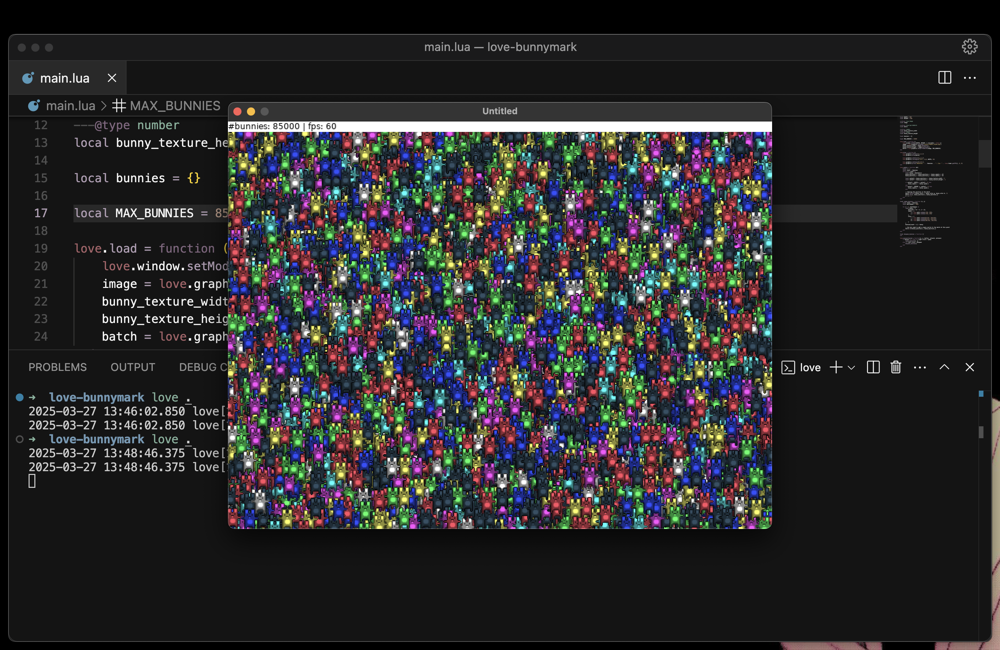

# love2d bunnymark

> running smoothly @60fps with 85,000 moving and differently colored bunnies



## Run

```
love .
```

## Implementations

### 1. sb_soa (SpriteBatch + Structure of Arrays)

set [cfg.lua](./cfg.lua)'s `IMPL_ID` to `"sb_soa"`

### 2. sb_aos (SpriteBatch + Array of Structures)

set [cfg.lua](./cfg.lua)'s `IMPL_ID` to `"sb_aos"`

### 3. gpu (GPU Instancing)

set [cfg.lua](./cfg.lua)'s `IMPL_ID` to `"gpu"`

## Credits

- [raylib [textures] example - bunnymark](https://www.raylib.com/examples/textures/loader.html?name=textures_bunnymark)
- [wabbit_alpha.png](https://github.com/odin-lang/examples/blob/5d24fd4388552d2bd6baf830230dcd045cd7187d/raylib/ports/textures/resources/wabbit_alpha.png)
- [OpenGL Tutorial 21 - Instancing](https://www.youtube.com/watch?v=TOPvFvL_GRY)
- [love.graphics.drawInstanced](https://love2d.org/wiki/love.graphics.drawInstanced)
- [AoS vs. SoA](https://www.youtube.com/watch?v=Dj3lkfIEUyA) - Even though LuaJIT doesn't emit SIMD instructions, SoA still helps with reducing memory allocations and reducing GC pressure.

## LICENSE

(The Unlicense) See [LICENSE.md](./LICENSE.md)
